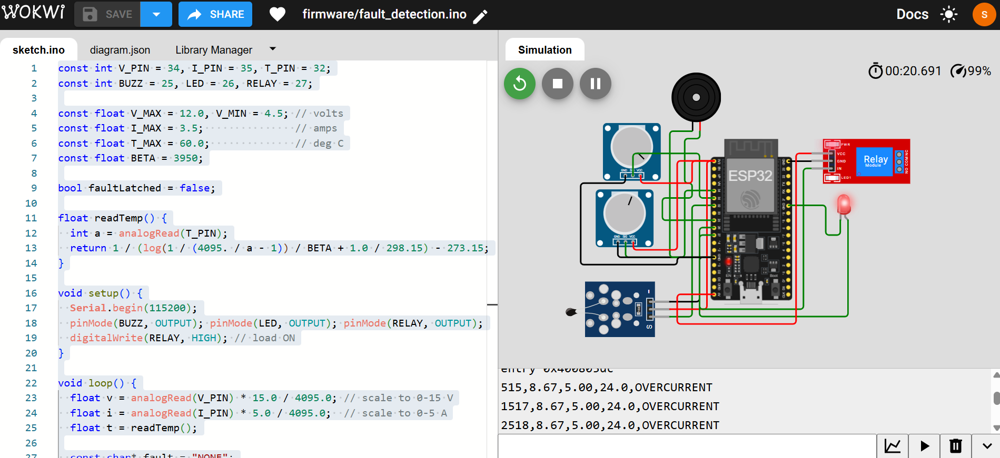
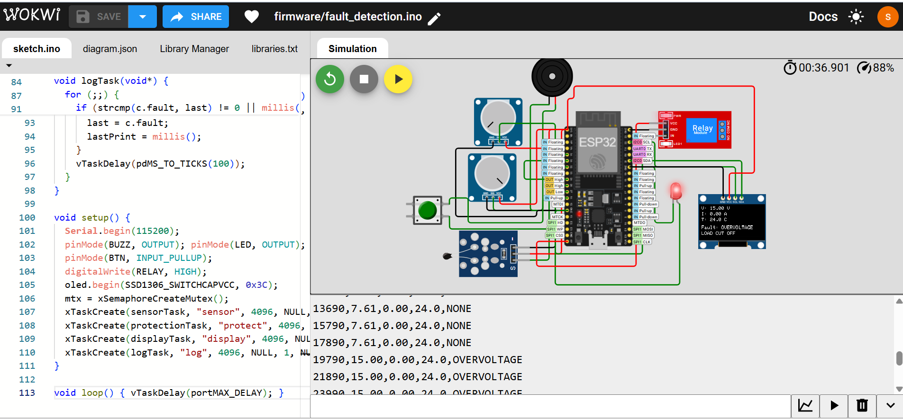

# ESP32 Embedded Fault Detection System

Simulated fault detection and load protection system on ESP32 (Wokwi).

## Features
- Monitors voltage, current, temperature
- Detects overvoltage, undervoltage, overcurrent, overheating
- Buzzer + LED alert, relay cuts off the load
- CSV serial logging
- FreeRTOS multitasking (sensing, protection, display, logging)
- OLED live status display
- Manual reset button

## Versions
- **v1**: basic fault detection, relay cut-off, serial logging
- **v2**: FreeRTOS tasks, OLED display, reset button

## Live Simulation
- [v1 in Wokwi](https://wokwi.com/projects/477939876572561409)

## Circuit
### v1

### v2

## Fault Thresholds
| Fault | Limit |
|---|---|
| Overvoltage | > 12 V |
| Undervoltage | < 4.5 V |
| Overcurrent | > 3.5 A |
| Overheat | > 60 °C |

## Project Structure
- `firmware/`: ESP32 code (v1 and v2)
- `hardware/`: Wokwi circuit files
- `docs/`: screenshots

## Tools
ESP32, Arduino framework (C++), FreeRTOS, SSD1306 OLED, Wokwi
